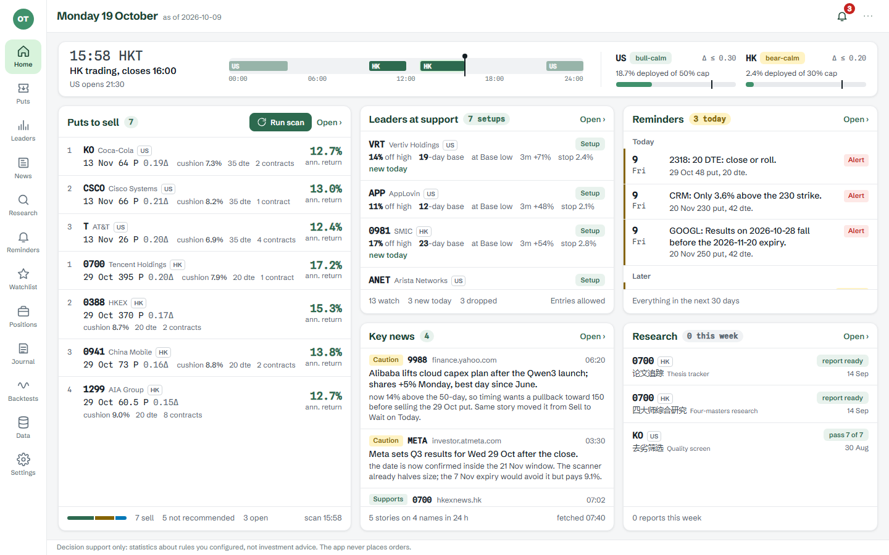
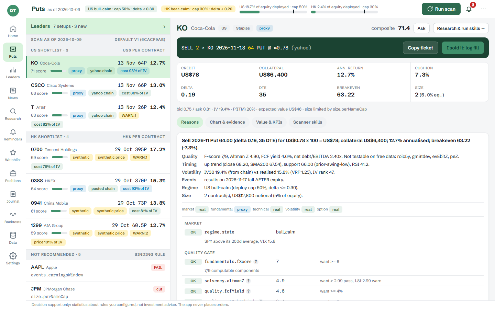
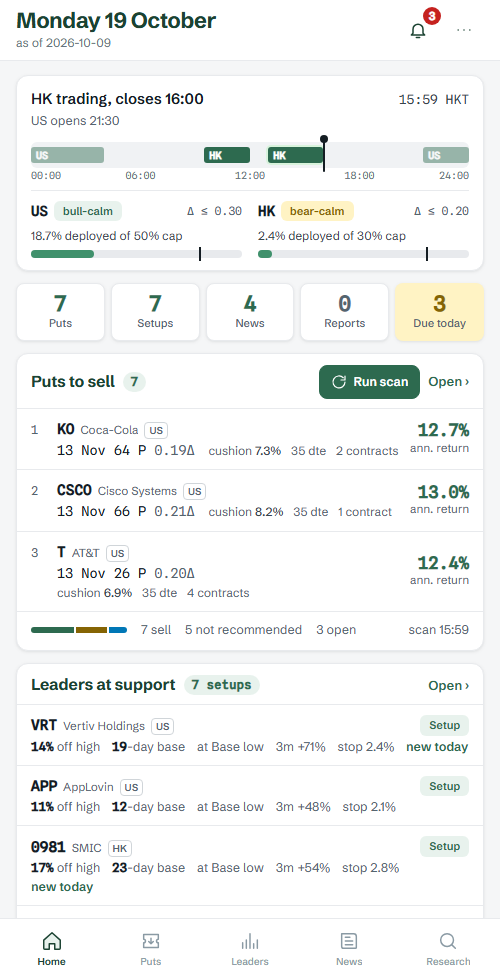
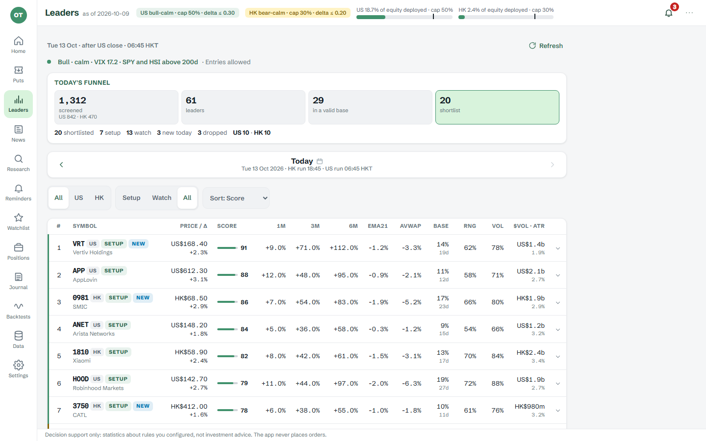
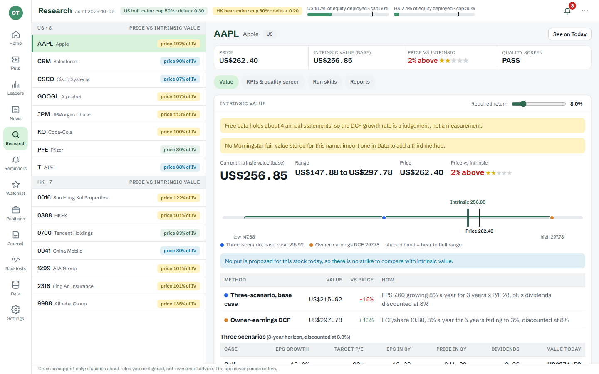

<div align="center">

# Option Trading

**为港股 + 美股自选股池打造的本地优先“卖出看跌期权（Sell Put）”决策辅助应用。**<br>
每天为你排出值得卖出的 Put，并给出理由，但绝不下单。

[English](README.md) · 简体中文

</div>



> **免责声明。** 本项目是个人研究工具，不构成任何投资建议，也不是券商：它不连接任何交易接口，不会下单、改单或撤单。
> 卖出期权的亏损可能远大于你收取的权利金。行情数据来自免费的非官方来源，可能延迟或有误。每一笔交易的责任由你自己承担。
> 本软件按“原样”以 MIT 许可证提供，不附带任何担保。本文中的截图来自项目自带的模拟 API，数字均为示例，不是推荐。

## 它做什么

你维护一份“愿意持有”的公司自选股池。每个交易日，应用在这份股池上运行一条由小型、带版本号的分析技能（skill）组成的流水线，
输出按顺序排好的“现金担保卖 Put”候选清单，每一条都附带理由：

```
自选股池 ─▶ 基本面闸门    质量、偿债能力、估值、事件风险              硬性 通过 / 不通过
         ─▶ 市场状态      SPX / 恒指 对比 200 日线，VIX / VHSI       Delta 上限与总仓位上限
         ─▶ 技术择时      趋势、回调、与支撑位的距离
         ─▶ 波动率优势    IV Rank、隐含波动率对比已实现波动率
         ─▶ 合约选择      到期窗口、Delta 区间、行权价对比支撑位、流动性、年化收益
         ─▶ 综合排序 ─▶ 仓位   按完整名义本金对比单股与组合上限
         ─▶ 理由说明      一张可以逐条反驳的理由表
```

默认参数是 v1 基线（约 30 到 45 天到期、Delta 0.15 到 0.30、行权价在支撑位下方、赚到 50% 权利金止盈、剩 21 天平仓、
亏损达到权利金 2 倍止损，见 [docs/00-overview.md](docs/00-overview.md) 第 4 节），所有参数都可配置、可回测。

**代码强制执行的设计规则**

- **技能是纯函数，只能读取截至“某个日期”的数据，绝不读取系统时钟。** 同一份代码既给今天的股池打分，也给回测中的每一天打分。
- **基本面数据按时点（point-in-time）处理。** 对日期 D 的一次运行，只能看到 `reported_at <= D` 的财报。
- **每一行都带证据**：机器可读的理由（`rule`、`value`、`threshold`、`passed`）和数据层级（`real` 真实、`proxy` 代理、
  `synthetic` 合成），让你知道该信任到什么程度。
- **风险按完整名义本金计算**（行权价 x 合约乘数），也就是被行权时你要付出的金额。券商保证金只作为第二个收益数字展示，
  从不决定仓位。
- **港股不是换个后缀的美股。** 期权合约规模来自独立的表（[data/hk-board-lots.csv](data/hk-board-lots.csv)），常常与正股每手股数不同；
  到期日是当月最后一个营业日的前一个营业日；财报是半年报，业绩公布日期数据稀疏。

## 页面

| 页面 | 用途 |
|---|---|
| **Home 首页** | 一屏看完整个桌面：待卖 Put、回调到支撑位的龙头股、重点新闻、提醒、研究。手机上是一行“速览条”。 |
| **Puts 待卖** | 按市场排序的候选清单，含理由表、图表、估值与 KPI，以及可复制的下单单据文本。**Ask** 可就当前这一条向模型提一个问题，回答基于扫描本身的数字。 |
| **Leaders 龙头** | 每日“回调买入”清单：20 只回调到支撑位的港美股市场龙头，附带筛选漏斗。 |
| **News 新闻** | 市场简报，以及与你的候选清单和持仓 Put 相关的新闻，每条按规则标为“支持”“谨慎”或“阻止”。 |
| **Research 研究** | 内在价值给出区间（三情景、所有者收益 DCF、可选 Morningstar 公允价值）、25 项 KPI、7 项“去劣”质量筛选，以及 AI 研究技能。 |
| **Watchlist 自选股** | 每只股票一行：价格、趋势、IV Rank、ROE、自由现金流收益率、业绩公布日和今日建议。 |
| **Positions 持仓** | 手动记录成交、每日盯市、提醒（赚到 50%、21 天到期、2 倍止损、被行权风险、财报早于到期日）以及 Wheel 轮动中的股票持仓。 |
| **Journal 日志** | 每日交易日记，支持 AI 改写（润色、精简、结构化、总结教训、翻译）。 |
| **Backtests 回测** | 用实盘规则回放过去多年，附带基准对比、定价误差检验和滚动前向（walk-forward）结果。 |
| **Data、Settings、Reminders** | 带实时日志的数据拉取、粘贴港股期权链、本金与参数、即将到来的业绩公布日和到期日。 |

命令行覆盖同样的功能（`pnpm cli --help`）；可选的进程内调度器（pg-boss，不需要 Redis）负责每日拉取数据、期权链快照、持仓盯市、
扫描、新闻和提醒。

<table>
<tr>
<td width="68%"></td>
<td width="32%"></td>
</tr>
<tr>
<td></td>
<td></td>
</tr>
</table>

## 项目状态

个人项目，按现状分享。它为“一个用户、一个组合”设计（登录只是一道门，不是多用户），只支持港股和美股，
开发和运行都在 **Windows** 上。macOS 和 Linux 未测试；与 Windows 相关的部分是 `scripts/` 里的辅助脚本，
以及查找 `claude` 和 Python 可执行文件的默认路径。没有任何托管服务：一切都在你自己的机器上，
连接你自己的 PostgreSQL 数据库。

## 零配置先看一眼

模拟 API 提供示例数据，不需要数据库，一分钟就能看到所有页面（只要 Node 22 和 pnpm 10）：

```bash
pnpm install
pnpm demo        # 示例数据 API 在 :4318，界面在 http://127.0.0.1:5173（Vite 输出的 "Local" 行会显示实际端口）
```

按 Ctrl+C 同时停止两者。不会保存任何数据，屏幕上的数字都是示例数据。

## 安装并使用真实数据

**环境要求：** Node.js 22 或更新版本、pnpm 10、PostgreSQL 16（原生安装，不需要 Docker）。

1. `pnpm install`
2. 创建数据库（例如 `createdb option_trading`），把 `.env.example` 复制为 `.env` 并设置 `DATABASE_URL`。
   如果要运行测试，还要设置 `PG_ADMIN_URL`，测试用它来创建临时数据库。
3. `pnpm db:migrate` 创建所有表、写入默认策略参数并载入交易所日历。
4. `pnpm app` 首次运行会构建界面、启动服务并打开 <http://127.0.0.1:3004>。首次登录页会要求你用服务端终端里打印的
   **设置码（setup code）** 创建账号。
5. 在应用里：**Settings** 设置你的本金，**Watchlist** 添加股票，**Data** 拉取价格和基本面，然后进入 **Puts** 点击 **Run scan**。

命令行版本的同样步骤，以及港股期权链粘贴、历史交易日志导入、盯市、Wheel、调度器和回测命令，都在
**[使用指南](docs/usage.md)** 中（目前只有英文）。

## 数据来源与可选集成

| 来源 | 用途 | 是否必需 |
|---|---|---|
| 通过 [yahoo-finance2](https://github.com/gadicc/node-yahoo-finance2) 访问 Yahoo Finance（非官方） | 价格、基本面、美股期权链、业绩日期、汇率 | 拉取真实数据时必需 |
| moomoo / Futu **OpenD**（只读） | 港股日线、最长 180 天的港股期权链、IV 历史回填 | 否；可改为粘贴期权链 CSV |
| CSV 导入 | 从券商界面复制的港股期权链、你过去的卖 Put 交易 | 否 |
| [Claude Code](https://claude.com/claude-code) 命令行 | AI 功能：研究技能、Ask、新闻简报与分类、Leaders 简报、日志改写 | 否；设置 `OT_SKILL_EXECUTOR=none` 或不安装命令行即可关闭 |
| [ai-berkshire](https://github.com/xbtlin/ai-berkshire) 提示词 | 仅用于六个由提示词驱动的研究技能；克隆后设置 `INVEST_AGENT_ROOT` | 否 |
| SMTP、Telegram、Google OAuth | 邮件登录链接、提醒推送、Google 登录 | 否 |

AI 运行会调用 `claude` 命令行，只使用只读工具（或完全不使用工具），并为每次运行设置费用上限（`OT_SKILL_MAX_BUDGET_USD`）。
模型输出只以带标签的文本形式展示和保存，不会反馈到扫描器的分数、规则或数字里，因为技能只能看到已存储的市场数据。

## 架构

一个 TypeScript 包（严格模式、ESM），模块边界受强制约束，另有一个 React 界面：

```
src/core         领域类型、港美日历、合约规格、提醒与告警规则、回撤调节器
src/indicators   技术指标、波动率估计、Black-Scholes、隐含波动率
src/skills       分析技能 S0 到 S8、注册表与流水线运行器（纯函数；只读截至某日的数据）
src/valuation    内在价值、KPI、质量筛选
src/providers    Yahoo、Futu OpenD、CSV、新闻与指数成分股适配器（只有命令行和定时任务可以导入）
src/backtest     回放引擎、合成期权定价器（Barone-Adesi-Whaley）、指标
src/leaders      Leaders 页面的选 Put 与视图辅助
src/journal      日记结构、模板、衍生字段与 AI 改写规则
src/db           Drizzle schema（schema 的唯一事实来源）、迁移、仓储
src/jobs         基于 pg-boss 的定时任务
src/server       Fastify API、登录、研究与 Ask 运行器、服务层
src/cli          命令行
web/             React 19 + Vite 界面（手机优先；web/mock 是模拟 API）
```

边界有两层保证：Biome 的 `noRestrictedImports` 规则，以及 [tests/structure.test.ts](tests/structure.test.ts)
（技能只能导入 `core` 和 `indicators`，不能读取时钟或环境变量）。建议先读 [docs/00-overview.md](docs/00-overview.md)，
再读 [docs/02-architecture.md](docs/02-architecture.md)；每份设计文档末尾的 “As built” 记录了实际实现，见
[docs/designs](docs/designs)。决策日志是 [DECISIONS.md](DECISIONS.md)，待办事项是 [TODOS.md](TODOS.md)。

## 开发

| 命令 | 作用 |
|---|---|
| `pnpm test` | 单元与集成测试；需要通过 `PG_ADMIN_URL` 连接 PostgreSQL（每个测试文件克隆一个临时数据库） |
| `pnpm test:web` | 界面单元测试，不需要数据库 |
| `pnpm test:e2e` | 基于录制数据的端到端场景，每个文件一个临时数据库 |
| `pnpm lint` / `pnpm typecheck` | Biome（含模块边界规则）/ 服务端与界面的 `tsc --noEmit` |
| `pnpm db:generate` | 修改 `src/db/schema.ts` 后生成迁移 |
| `pnpm app:server` + `pnpm web:dev` | 对着真实服务端开发界面（Vite 把 `/api` 代理到 3004 端口；用 `API_TARGET` 指向别处） |
| `pnpm demo` | 界面对接示例数据的模拟 API，不需要数据库 |

测试从不访问网络：`tests/helpers/no-network.ts` 会让任何意外的 `fetch` 失败，数据提供方用录制的 HTTP 数据做测试。
指标的 golden fixtures 由 TA-Lib 在一条合成序列上生成（`tests/fixtures/gen/`），从不手工编辑。

## 安全说明

服务只监听 `127.0.0.1`，拒绝 `Host` 不是本机的请求，拒绝跨源的浏览器请求，写操作要求 `Content-Type: application/json`，
所有数据接口都要求已登录的会话。登录方式有密码（scrypt）、Google，或一次性邮件链接。没有反向代理、`APP_URL` 和
事先创建好的账号，请不要把它暴露到公网；`OT_AUTH=off` 只适用于没有其他人能访问的机器。仓库中不存放任何密钥
（`.env` 已被 git 忽略；请复制 `.env.example`）。如需报告安全漏洞，请使用本仓库的 GitHub 私密安全公告，而不是公开 issue。

## 数据与法律说明

- 本项目与 Yahoo、moomoo / Futu、Morningstar、恒生指数公司、港交所（HKEX）、Wikipedia、Anthropic 均无关联，也未获其背书。
  产品名称归各自所有者所有。
- **Yahoo Finance 数据。** Yahoo 的接口是非官方的，受 Yahoo 使用条款约束。应用把数据拉取到你自己的数据库、在你自己的机器上、
  供你自己使用；请勿再分发拉取到的数据。`tests/fixtures/http/` 中是裁剪后的录制响应，仅用于让测试离线运行，如有要求会移除。
- **指数成分列表。** [data/universe-us.csv](data/universe-us.csv) 和 [data/universe-hk.csv](data/universe-hk.csv) 编译自公开来源，
  包括 Wikipedia（CC BY-SA 4.0）以及恒生和港交所的公开名单。依赖任何一只股票前请自行核实。
  `data/hk-board-lots.csv` 中的港股期权合约规模会随时间变化：请向券商或港交所核对。
- **改编文本。** `src/server/research/knowledge/` 改编了
  [himself65/trade-skills](https://github.com/himself65/trade-skills) 的十条要点（其 README 声明为 MIT 许可），详见该目录下的 `LICENSE.md`。
- **AI 提示词。** 研究技能在运行时读取你自己克隆的 [ai-berkshire](https://github.com/xbtlin/ai-berkshire)（MIT）中的提示词，
  本仓库不包含它们。

## 参与贡献

欢迎提 issue：程序缺陷、失效的数据源、港股合约规格的更正。这是个人项目，写大型 Pull Request 之前请先开 issue，
回复可能较慢。

## 许可证

[MIT](LICENSE) © 2026 haijin
